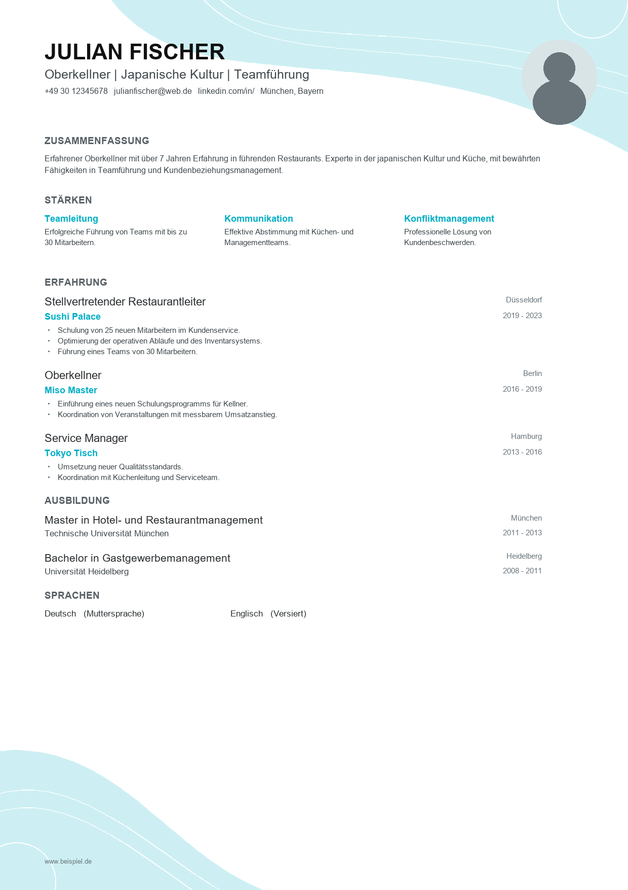
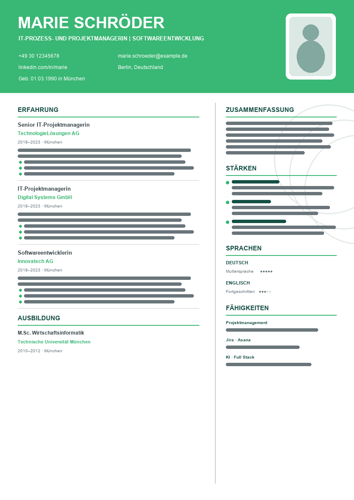
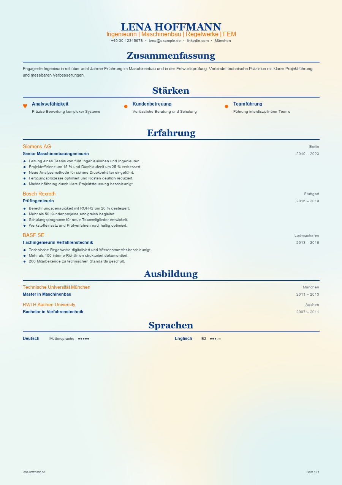

# BewerbungsManager

> Create, organize, and export professional job application documents locally on your Windows PC.

[](https://github.com/mustafa-oezdemir/bewerbung-studio/actions/workflows/ci.yml)
[](LICENSE)


BewerbungsManager is a desktop application for the full job application process: from a job posting and profile to a cover letter, cover sheet, CV, and complete application package, with a calendar and task list. Application data is stored locally in the workspace you choose. Small application settings, such as the workspace path, are also stored in Electron's local user data folder. **The application interface is in German.**

**Official downloads:** [GitHub Releases](https://github.com/mustafa-oezdemir/bewerbung-studio/releases). There is currently no public Windows release.

## Download

When a public release becomes available, it will be published only on [GitHub Releases](https://github.com/mustafa-oezdemir/bewerbung-studio/releases). Official Windows files are built from this repository's source by GitHub Actions. Local builds are intended for testing only.

| File | Use |
| --- | --- |
| `BewerbungsManager-<Version>-x64-Setup.exe` | Standard Windows installation with a selectable installation folder and Start menu and desktop shortcuts |
| `BewerbungsManager-<Version>-x64-Portable.exe` | Runs without installation |
| `SHA256SUMS.txt` | Checksums for integrity verification |

Both versions contain the same application. Your application data resides in a folder you choose, outside the installation folder.

> No Windows files are available for download before the first public release. If a prerelease explicitly marked **UNSIGNED/PREVIEW** is published later, Windows may show a SmartScreen warning. Verify its SHA-256 checksum against the included `SHA256SUMS.txt`:
>
> ```powershell
> Get-FileHash .\BewerbungsManager-<Version>-x64-Setup.exe -Algorithm SHA256
> ```

> **Feature status:** The description below applies to the current source code. It does not promise that an older binary or an unpublished release has these features.

## Why BewerbungsManager?

- **Everything in one place:** Company, position, status, dates, documents, and tasks for each application.
- **Main profile as a template:** New applications receive their own copy of the selected main profile. In Documents, you can apply a different main profile or refresh the copy from its current data without changing other applications.
- **Ready to send:** A Word cover letter, PDF cover sheet and CV, and a complete merged PDF application package.
- **Deadlines in view:** Application deadlines automatically appear in the calendar and task list.
- **Control over your data:** A local folder, no user account, and optional master password protection.

## Features

### Applications

- Validated creation wizard with local draft caching
- Company, contacts, and position, including reference, source, link, posting text, work model, contract type, and salary
- Status history from *Draft* to *Offer*, *Rejection*, *Withdrawn*, or *Archived*, with reasons for rejections
- Application deadlines and interview and contract dates
- Dashboard with status counts and success rate; search and filters across applications
- Matching between the job posting and skills recorded in the profile

### Documents

- **Cover letter** as an editable Word file (DOCX) populated with application data
- **Cover sheet** in three designs (Klassisch, Pastell, Akzentband); preview and PDF use the same presentation
- **CV** in several designs, with an editor for sections that can be shown, hidden, and reordered, plus automatic page breaks
- **Application package** as one merged PDF: cover sheet, cover letter, CV, references, and certificates
- **References and certificates** stored centrally as PDFs and linked to individual applications
- Application email text as a Markdown file

Sample Word CV templates with example data are included in [`bewerbung-studio/public/templates`](bewerbung-studio/public/templates):

<p>
  
  
  
</p>

### Organization

- **Calendar** with month and agenda views
- **Application deadline:** Creates a calendar event and a high priority ToDo task automatically; both follow changes to the deadline
- **ToDo** with priority, due date, and notes; application tasks and personal tasks can be filtered separately
- Automatic application tasks become inactive after *Rejection*, *Offer*, *Withdrawn*, or *Archived* and reappear if the status is changed back
- Follow-up reminders after a configurable number of days
- Desktop notifications for calendar events with reminders

### Data management

- Multiple main profiles; each application keeps its own profile copy for documents
- Freely selectable application folder (workspace) and support for moving to another computer
- Daily automatic backups, full backups, and JSON export
- Optional encryption with a master password
- Light, dark, and system themes

## Quick start

1. When available, download Setup or Portable from GitHub Releases and verify its checksum.
2. Start the application.
3. Choose the application folder where all application data will be stored.
4. Optionally enable encryption.
5. Create a profile.
6. Create your first application.

## Data and privacy

BewerbungsManager processes personal information such as addresses, phone numbers, email, CVs, references, and application documents.

- Data is stored locally in the selected application folder, which you can change at any time.
- There is no user account or proprietary cloud service.
- The reviewed application code contains no telemetry or automatic update checks. The application folder is transferred only through the Git synchronization described below. External HTTP/HTTPS links open in the system browser only when you act on them; the browser and destination site have their own privacy practices.
- Automatic and manual backups are built in; encryption is optional.

**Git synchronization:** If the application folder is itself a Git repository whose `origin` points to `https://github.com/mustafa-oezdemir/bewerbung.git`, the application automatically transfers changes from **Bewerbungen** (Applications) after **Bewerbung anlegen** (create application), after each **Bereich speichern** (save section) that actually changes data, and after a status change. Once data and Word documents have been saved locally, it creates a commit and runs a normal `git push` of the current branch. It stages only the `data` folder, excluding logs, crash reports, Electron sessions, and caches; other repository files are left alone. Changes made in other areas are transferred with the next such synchronization. The application does not change the remote, force push, rebase, or store credentials; Windows Git authentication (Git Credential Manager) handles sign-in. If Git is missing, `origin` points elsewhere, or the push fails, the change remains saved locally and the application reports: “Änderungen wurden lokal gespeichert, konnten aber nicht zu GitHub übertragen werden.” (Changes were saved locally but could not be transferred to GitHub.) Earlier commits remain on disk and on the remote; remove them separately if needed.

The full [privacy policy](PRIVACY.md) also covers exports, backups, and local retention.

## Workspace and moving to another computer

`workspace.json` contains settings and relative references. Each application has its own profile and document details in `bewerbung.json`. Main profiles are individual JSON files under `Setting/Profile`; dates, tasks, attachment references, and custom CV designs are in `Setting/Settings/collections.json`. Cover letters, references, and other documents remain separate files in the application folder.

### Continue on another computer

1. Under **Einstellungen → Übertragen & Sicherung**, use **Für anderen Computer kopieren …** (copy for another computer) to copy the complete data set to a destination folder, or copy or securely synchronize the whole application folder yourself.
2. Start BewerbungsManager on the new computer.
3. On the start screen or under **Einstellungen → Datenbestand & Workspace**, select **Workspace-Datei auswählen …** (select workspace file) and choose `workspace.json` from the copied folder.
4. The data set loads from its new location. If encrypted, enter the master password or recovery key.

To move the application folder on the same computer, use **Einstellungen → Speicherort → Speicherort ändern …** (Settings → Storage location → Change location). A full backup is created first and the old folder is retained. If encryption is active, copy the data set instead and open the copy via **Workspace-Datei auswählen …**.

### Application folder structure

```text
<application folder>/
└── data/
    ├── Bewerbungen/          bewerbung.json per position, plus cover letter, CV, cover sheet, email, ...
    ├── Zeugnisse/
    ├── Zertifikate/
    ├── Absagen/
    └── Setting/
        ├── Settings/
        │   ├── workspace.json    settings and relative file references
        │   └── collections.json  dates, tasks, and central references
        ├── Profile/           main profiles as individual JSON files
        ├── Backups/
        └── Muster/            templates
```

See [`bewerbung-studio/README.md`](bewerbung-studio/README.md) for more about storage.

## Data security and encryption

You can optionally protect the data set with a master password during initial setup or later under **Einstellungen → Datensicherheit & Verschlüsselung** (Settings → Data security & encryption).

- **Method:** AES-256-GCM protects data and files. Argon2id derives a key from the master password to protect a random data key.
- **Master password:** At least 14 characters.
- **Recovery key:** Shown during activation; it can be copied or saved as TXT and can unlock the data if the password is unavailable. If both are lost, recovery is impossible.
- **Automatic locking:** After 5, 15 (default), 30, or 60 minutes, or never; manual locking is also available.
- **Remember on this device:** Optional, using Windows device protection through Electron `safeStorage`. The key is not in the application folder.
- **Backups:** Managed backups in the data folder are encrypted too.
- **Moving computers:** The data set remains portable and can be unlocked on another computer with the master password or recovery key.

### Limits

Encryption protects the contents of the managed `data` folder, with these limits:

- Folder and file names remain visible.
- Files deliberately exported from the data set (PDF, DOCX, JSON backup, settings) are unencrypted outside it.
- Opening a document in an external program such as Word creates a temporary decrypted copy outside the application folder. It is removed after one hour, on exit, and on the next start. Secure deletion on SSDs cannot be guaranteed.
- Previous unencrypted file versions, copies, and Git commits are not removed retroactively.
- Encryption does not fully protect data while the application is unlocked or the operating system is compromised.
- Git synchronization transfers files as stored in the application folder: encrypted when encryption is active. Previous unencrypted commits remain on the remote.

Create your own external backup before enabling encryption for the first time.

## Backup and recovery

Under **Einstellungen → Übertragen & Sicherung** (Settings → Transfer & Backup):

- **Daily automatic JSON backup** of the data set (`workspace-JJJJ-MM-TT.json`) in `data/Setting/Backups`, with configurable retention from 3 to 50 backups.
- **Jetzt sichern** (back up now) creates a complete backup of the application folder in the backup folder, including checksums for every file.
- **JSON-Sicherung exportieren** (export JSON backup) and **Sicherung wiederherstellen** (restore backup, with an automatic backup of the current state first), plus export and import of settings.
- Before deleting an application, its data is archived as JSON in `Silinenler`.

Keeping an additional copy of the entire application folder in a second location is recommended.

## System requirements

- Windows 10 or 11, 64-bit (x64)

Other operating systems and architectures are not published.

## Development

Requirements: [Node.js](https://nodejs.org/) 24 (as in CI), npm, and Git. The application is in the `bewerbung-studio` subfolder.

```bash
git clone https://github.com/mustafa-oezdemir/bewerbung-studio.git
cd bewerbung-studio/bewerbung-studio
npm ci
npm run dev
```

`npm run dev` starts Vite with the Electron plugin and opens the desktop application. `npm start` starts the already built application and requires `npm run build` first. To run only the interface in a browser, without Electron:

```powershell
$env:VITE_RENDERER_ONLY="1"; npm run dev
```

For development and tests, `BEWERBUNG_ROOT_PATH` can set the data folder. Never point it at your real application data.

### Scripts

Run all scripts from the application folder containing `package.json`.

| Command | Purpose |
| --- | --- |
| `npm run dev` | Development mode with Electron |
| `npm start` | Start the built Electron application |
| `npm run build` | Type check and production build |
| `npm run typecheck` | Check TypeScript |
| `npm test` | Run Vitest tests |
| `npm run release:check` | Type check, tests, and build |
| `npm run dist:win` | Create Windows Setup, Portable, and checksums |
| `npm run dist:win:signed` | As above, with code signing (certificate required) |
| `npm run dist:win:installer` | Build only the installer |
| `npm run dist:win:portable` | Build only the portable version |

The stack includes Electron, React, strict TypeScript, Vite, Tailwind CSS, Zustand, and Zod; documents use docxtemplater, PizZip, and pdf-lib. Exact versions are in [`bewerbung-studio/package.json`](bewerbung-studio/package.json).

## Tests

Run `npm test` from the application folder (see [Development](#development)). Tests use Vitest and sit alongside the code (`*.test.ts`, `*.test.tsx`). Run `npm run release:check` before opening a pull request.

## CI/CD and releases

```text
PR / codex/clean-release
→ CI
→ Typecheck
→ Tests
→ Build

vX.Y.Z (tag)
→ Windows Release
→ Setup
→ Portable
→ SHA256
→ GitHub Release
```

The [`ci.yml`](.github/workflows/ci.yml) and [`release.yml`](.github/workflows/release.yml) workflows call the existing npm scripts. A version tag must **not** publish a GitHub Release without the required signing secrets. A manual workflow run may create unsigned test artifacts but does not publish them automatically. See [`bewerbung-studio/RELEASE.md`](bewerbung-studio/RELEASE.md) for the checklist, signing, and exact procedure. Version-specific changes will appear in the GitHub release notes.

## Code signing policy

The project is openly licensed under [Apache-2.0](LICENSE). The sole official source is <https://github.com/mustafa-oezdemir/bewerbung-studio>, and the official download location is [GitHub Releases](https://github.com/mustafa-oezdemir/bewerbung-studio/releases). Production binaries are built only by GitHub Actions from this repository. Roles, privacy rules, and the pending SignPath status are in the full [code signing policy](CODE_SIGNING.md).

If SignPath Foundation approves free signing and it is used for a release, its download page will include this notice:

> Free code signing provided by SignPath.io, certificate by SignPath Foundation

No SignPath signing has been configured or approved yet.

## Project structure

```text
bewerbung-studio/
├── .github/
│   ├── ISSUE_TEMPLATE/
│   ├── workflows/               CI and Windows releases
│   └── pull_request_template.md
├── bewerbung-studio/            application
│   ├── electron/                main process: storage, files, PDF/DOCX, templates, encryption
│   ├── src/
│   │   ├── views/               dashboard, applications, calendar, ToDo, documents, profile, settings
│   │   ├── components/          wizard, CV templates, cover sheet
│   │   └── shared/              schemas, domain rules, pagination
│   ├── scripts/                 release build, checksums, QA scripts
│   ├── public/templates/        Word samples
│   ├── package.json
│   └── RELEASE.md
├── CODE_OF_CONDUCT.md
├── CONTRIBUTING.md
├── LICENSE
├── NOTICE
├── README.md
└── SECURITY.md
```

## Contributing

Contributions are welcome; see [CONTRIBUTING.md](CONTRIBUTING.md) and the [code of conduct](CODE_OF_CONDUCT.md). Do not commit real application data or post it in issues or pull requests.

## Security

Do not report security vulnerabilities publicly. See [SECURITY.md](SECURITY.md).

## License

BewerbungsManager is released under the Apache License 2.0. See [LICENSE](LICENSE) and [NOTICE](NOTICE).
